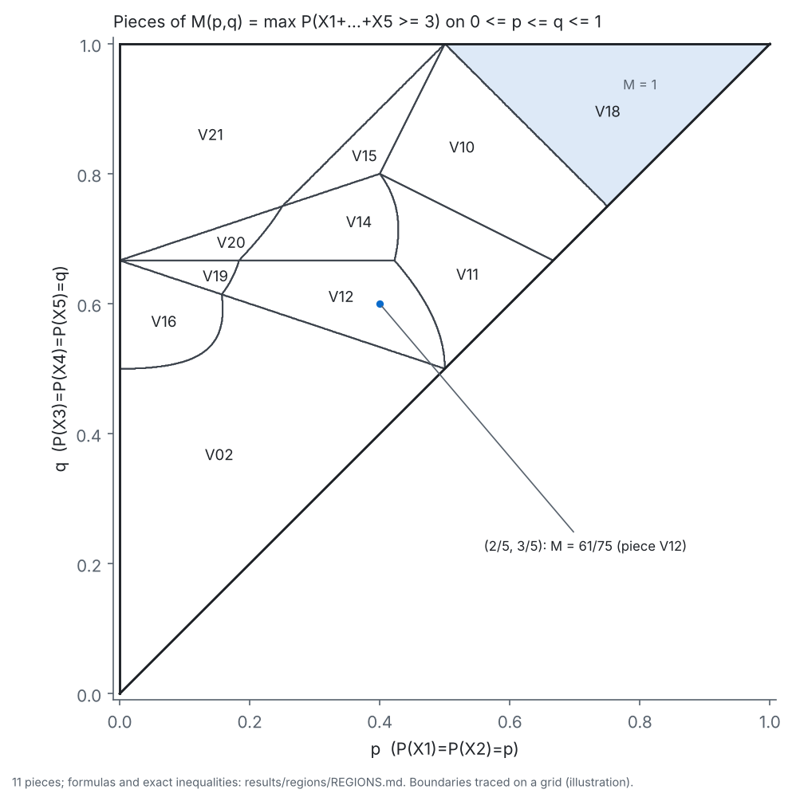

# pairwise-bound

KAIST 「인공지능기반수학발견」 개인 Math Research 과제 저장소.

## 문제

X1, …, X5 ∈ {0,1}이고 다음을 가정한다.
- P(X1=1)=P(X2=1)=p
- P(X3=1)=P(X4=1)=P(X5=1)=q
- 서로 다른 두 변수는 모두 독립이다(상호 독립은 가정하지 않음).

이때 다음 값과 이를 달성하는 결합분포를 구한다.

M(p,q) = max P(X1+X2+X3+X4+X5 ≥ 3),  0 ≤ p ≤ q ≤ 1

모든 최종 주장은 유리수 정확 계산과, 최적화 코드와 분리된 독립 검증기로 확인한다.

> **11/1 데모 제출:** 실행 방법과 출력 해설은 [`SUBMISSION.md`](SUBMISSION.md)에 있다. 대표 사례 출력 예시는 [`results/demo_output.txt`](results/demo_output.txt)에 있다.

## 빠른 시작

Python 3.11 이상(3.11, 3.12, 3.13에서 확인).

```bash
python3 -m venv .venv && . .venv/bin/activate
pip install -r requirements.txt           # 최소 버전 목록 (정확한 기록 환경은 requirements.lock)
python -m scripts.demo                    # 대표 사례 p=2/5, q=3/5
python -m scripts.demo --p 1/5 --q 1/2    # 다른 유리수 입력
pytest                                    # 전체 테스트
```

`pip install -e '.[dev,symbolic,plot]'`로 패키지를 설치해도 같은 명령이 동작한다.

데모는 다음을 출력한다(네트워크·LLM API 호출 없음).
- 정확한 최댓값
- 12상태 (A,B) 달성분포와 이를 복원한 32상태 분포
- 상한 증서(쌍대 다항식)와 그 값의 (p,q) 이차식
- HiGHS 부동소수점 교차확인
- 독립 검증기(`python -I verifier/verify.py`)의 28개 검사 결과

대표 사례 출력 요약:

```
M(p, q) = 61/75  ~= 0.8133333333
f(a, b) = a - (1/3)a(a-1) + (1/6)b(b-1) - (1/6)ab      # f >= 1[a+b>=3] on 12 points
E f(A, B) = Q(p, q) = -(2/3)p^2 - pq + q^2 + 2p = 61/75
28/28 checks passed
VERDICT: PASS
```

## 연구 방향 재평가 (2026-10-29)

11/1까지의 결과(아래)는 표준 도구(LP 쌍대, 대칭화, 매개변수 LP)로 한 사례를 정확히 푼 것이다. 독립 재평가에서 "사례 계산에 그친다"는 우려가 타당하다고 판단했다([`notes/research_reassessment.md`](notes/research_reassessment.md)). 그래서 질문을 다음으로 바꿨다.

> **쌍별 독립에서 두 모멘트(Boros–Prékopa) 상한은 서로 다른 주변확률일 때 언제 정확하고, 왜 깨지는가?** (일반 n, k)

지금까지 확보한 결과(증명: [`notes/proofs/exactness.md`](notes/proofs/exactness.md), 상태: claims C15–C25):
- **확실성 판정:** P̄ = 1이면 모든 j에서 Σ_{l≠j} p_l ≥ k다(일반 증명).
  - 역은 k ∈ {1, 2, n−2, n−1, n}에서 증명했다. 따라서 n ≤ 5는 전부 해결되었다.
  - k = 2(2026-10-30)는 벗겨내기 구성으로 증명했다. 법칙을 "정확히 k개가 1인 설계"와 "최댓값 좌표가 모두 1인 쌍별 독립 법칙"의 혼합으로 쓴다.
  - 3 ≤ k ≤ n−3은 그 설계의 존재(추측 D, 탐색 553점 모두 성립)로 환원되었고, 아직 추측이다.
- **정확성의 장애:** 조건부 평균 E[S∣X_j] = 1 + Σ_{l≠j}p_l 또는 Σ_{l≠j}p_l에서 세 가지 장애가 나온다.
  - BP-최적 층과의 구간 불일치
  - 지지 {0,k,n}에서의 두 근 경직성
  - 층 측도의 음수

  이것들이 충분하지 않음을 보이는 정확한 반례도 있다.
- **SSS 이차항의 필요충분조건:** P̄ = S₂/C(k,2)일 필요충분조건을 구했다. 동일 주변확률이면 R–N Prop. 4.3(b)와 같다. 따름: P̄(n,2,p) = S₂ ⇔ max_j Σ_{l≠j}p_l ≤ 1.
- **오차의 정량화:** 경우 (b)에서 BP − P̄ ≥ max_j|Δ_j|/κ(n,k)(Δ_j는 경직성 결함). 동일 주변확률 근방에서 오차가 섭동 크기에 1차로 커진다.
- **국소 이분법:** 동일 주변확률 근방에서 BP의 정확성은 R–N Theorem 4.1의 경우 (a)(c)에서는 열린 집합으로 유지되고, 경우 (b)에서는 대수적 부분집합으로 줄어든다. 근거는 층 합집합의 모멘트 차원 분류다.
- **설명:** R–N Example 3.2(n=12)에서 BP와 순서 기반 BP가 정확한 칸과 아닌 칸 24개를 모두 정확한 증서와 함께 설명했다([`results/exactness/rn_example_3_2.md`](results/exactness/rn_example_3_2.md)). 원래 2+3 문제에서 BP가 정확한 조각(V02, V16, V18)과 아닌 조각의 원인도 같은 원리로 설명했다.

```bash
python -m scripts.explain_rn_example        # R–N Example 3.2의 24칸 판정 (약 8초)
python -m scripts.explore_exactness all     # 탐색 실행 (부동소수점, 약 4분)
```

## 현재까지의 결과 (원래 2+3 문제)

상태 정의와 근거는 [`notes/claims.md`](notes/claims.md)에 있다.

**주결과 (컴퓨터 보조 증명, 독립 검증기 PASS).** 0 ≤ p ≤ q ≤ 1에서 M(p,q)는 11개 조각으로 나뉜 조각별 이차식이다. 각 조각에서 다음이 정확히 주어진다([`notes/proofs/theorem_AB.md`](notes/proofs/theorem_AB.md), [`results/regions/REGIONS.md`](results/regions/REGIONS.md)).
- 공식(이차식)
- 영역(이차 부등식)
- 달성분포((p,q)의 다항식)



| 주장 | 상태 |
|---|---|
| M(2/5,3/5) = 61/75, 대표점은 조각 V12 = 2p − 2p²/3 + q² − pq의 내부 | 정확 계산 검증 |
| 32상태 LP ⇔ 12상태 (A,B) LP (S₂×S₃ 대칭화) | 증명됨 ([`reduction.md`](notes/proofs/reduction.md)) |
| 정리 A: [0,1]²에서 M = 21개 쌍대 꼭짓점 이차식의 최솟값 | 증명됨 (컴퓨터 보조) |
| 정리 B: D 내부의 활성 조각은 정확히 11개. 영역은 facet 부등식, 달성분포는 다항식 | 증명됨 (컴퓨터 보조) |
| 따름정리 C (2026-10-29 정정): Ramachandra–Natarajan의 BP형 상한(두 모멘트·순서 기반·강화판)은 V02, V16, V18 조각에서만, SSS형은 V02, V18에서만, Chebyshev형은 V18에서만 tight (나머지 조각 내부에서는 내부 없는 예외 집합을 빼고 엄밀히 느슨). 정정 전 판은 세 종류가 같은 영역에서 tight하다고 잘못 썼다 | 증명됨 (컴퓨터 보조) |
| p↔q 비대칭: M(3/5,2/5)=19/25 ≠ 61/75 | 정확 계산 검증 |
| p=q 단면 = R–N Theorem 4.1 (재현) | 정확 계산 검증 + 문헌 |

조각 분류를 재현하려면 다음을 실행한다.

```bash
python -m scripts.classify          # 증서 + REGIONS.md 생성, 검증기 실행 (약 10초)
python -I verifier/verify.py results/regions/region_certificate.json
python -m scripts.plot_regions      # 그림 (예시용)
```

## 저장소 구조

| 경로 | 역할 |
|---|---|
| `src/pwbound/model.py` | 32·12상태 모형 정의, 원·쌍대 복원 (단일 정의 출처) |
| `src/pwbound/exact_lp.py` | 12상태 LP 기저 전수열거 (Fraction), 쌍대 꼭짓점 |
| `src/pwbound/float_lp.py` | HiGHS 32·12상태 LP (교차확인 전용, 제약을 독립적으로 구성) |
| `src/pwbound/univariate.py` | S의 이항모멘트 LP (p=q 대조, 두 모멘트 상한) |
| `src/pwbound/cert.py` | 점 증서 JSON 생성 |
| `src/pwbound/parametric.py`, `region_cert.py`, `poly.py`, `trimin.py` | 매개변수 LP: tight 집합, 원뿔 facet, 목격점, 지배 덮개, 영역 증서 |
| `src/pwbound/rn_bounds.py` | Ramachandra–Natarajan 상한 구현과 쌍대점 집합 |
| `src/pwbound/general.py` | 일반 n의 주변확률: BP 최적 법칙, 정확성 필요조건 판정, 층 차원, 정확한 법칙 검사·재구성, HiGHS 탐색 |
| `verifier/SPEC.md`, `verifier/verify.py` | 독립 검증기 명세와 구현 (표준 라이브러리만) |
| `scripts/demo.py` | 한 명령 데모 |
| `scripts/make_certificate.py` | 임의 (p,q)의 증서 생성 |
| `scripts/classify.py`, `scripts/plot_regions.py`, `scripts/plot_slice.py`, `scripts/scan.py`, `scripts/junctions.py` | 조각 분류·영역도·단면 비교 그림·격자 탐색·교점표 |
| `scripts/explain_rn_example.py`, `scripts/explore_exactness.py` | R–N Example 3.2 설명(정확 증서), 정확성 탐색 실행 |
| `results/certificates/`, `results/regions/`, `results/exactness/` | 점 증서, 영역 증서·문서·그림, Example 3.2 판정표 |
| `tests/` | 모형, 정확 해법, 교차확인, 검증기 음성 테스트, 검증기 독립성 |
| `notes/` | 계획, 문제 정의, 증명, 주장 상태, 문헌, 연구일지, AI 상호작용 기록, 인계 문서 |

## 문서

- 연구 재평가와 새 질문: [`notes/research_reassessment.md`](notes/research_reassessment.md)
- 계획(11/1까지): [`notes/PLAN.md`](notes/PLAN.md)
- 문제와 가정: [`notes/problem.md`](notes/problem.md)
- 증명: [`notes/proofs/`](notes/proofs/)
- 주장 상태: [`notes/claims.md`](notes/claims.md)
- 선행연구: [`notes/literature.md`](notes/literature.md)
- 연구일지: [`notes/journal.md`](notes/journal.md)
- AI 상호작용 기록: [`notes/ai_log.md`](notes/ai_log.md)
- 세션 인계: [`notes/HANDOFF.md`](notes/HANDOFF.md)
- 발표 자료에 넣을 내용(검토용 초안): [`notes/presentation_content.md`](notes/presentation_content.md)
- 데모 제출 안내: [`SUBMISSION.md`](SUBMISSION.md)
