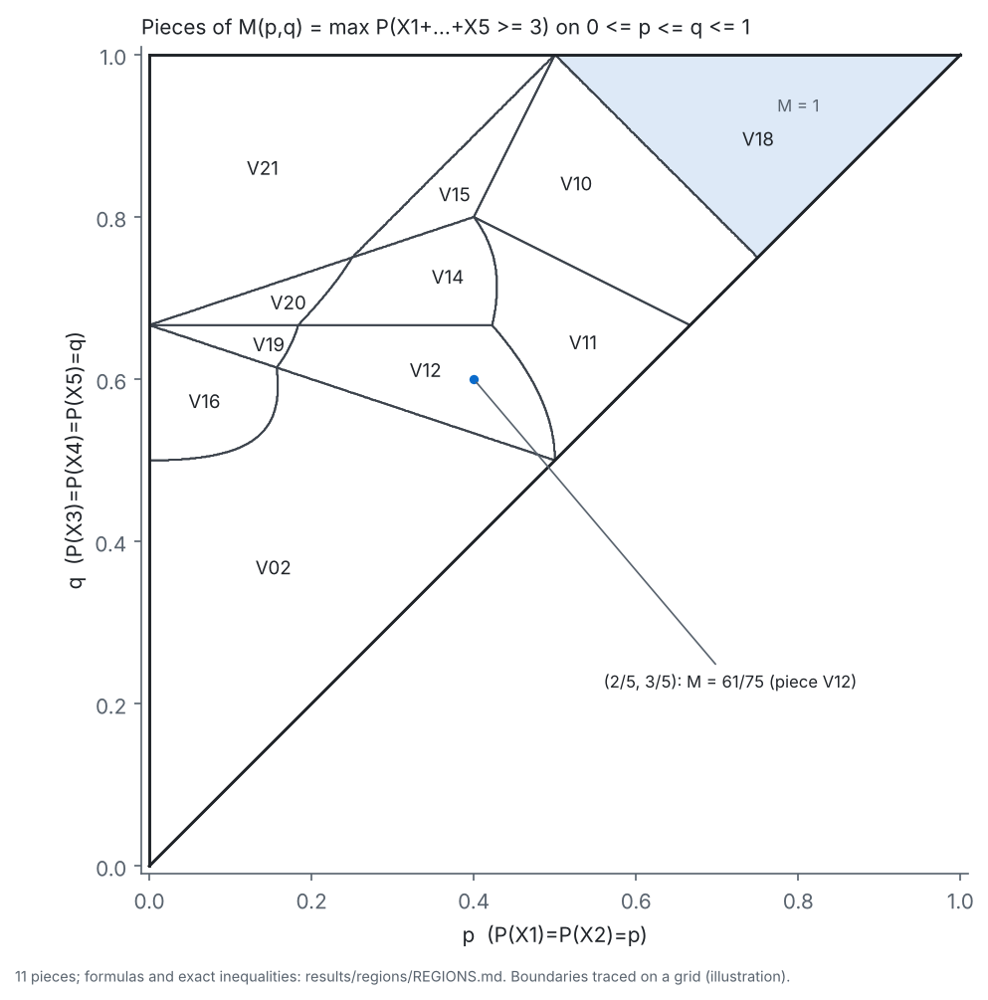
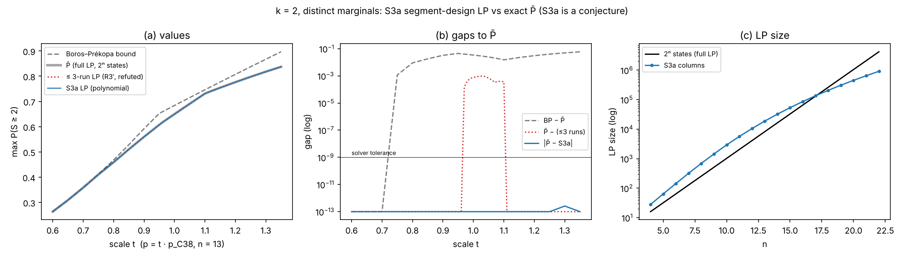

# pairwise-bound

KAIST 「인공지능기반수학발견」 개인 Math Research 과제의 데모 제출본이다(2026-11-17 기준).

**한 줄 요약.** 0/1 확률변수들이 둘씩만 독립일 때, 합이 k 이상일 확률의 최댓값 P̄(n,k,p)를 구한다.
- 원래 과제 문제(변수 5개, 2+3 묶음)는 완전히 풀었다. 결과는 정확한 분수와 독립 검증기로 확인된다.
- 지금은 선행논문(Ramachandra–Natarajan, 이하 R–N)이 열어 둔 문제, 즉 "k ≥ 2이고 주변확률이 서로 다를 때 P̄를 효율적으로 계산할 수 있는가"를 k = 2부터 다루고 있다.
- 현재 상태: 다항식 크기 LP(**S3a**)가 P̄와 같다는 추측을 세웠다. 수많은 시험점과 정확한 유리수 검증 8곳에서 일치했다. **증명은 아직 없다.**

---

## 1. 문제

X₁, …, X_n ∈ {0,1}이고 P(X_i = 1) = p_i이며, 모든 쌍 (X_i, X_j)가 독립이다. 세 개 이상의 상호 독립은 가정하지 않는다.

  P̄(n,k,p) = max P(X₁ + … + X_n ≥ k)

- 이 값은 2ⁿ개 상태 위의 선형계획(LP)으로 정확히 계산된다. 하지만 n에 대해 지수 크기다.
- LP 쌍대는 "모든 x ∈ {0,1}ⁿ에서 q(x) ≥ 1{|x| ≥ k}인 이차식 q"다. 그런 q 하나가 있으면 E q가 상한이 된다. 이 저장소에서는 이것을 **증서**라고 부른다.
- 하한은 실제 결합분포(법칙)로 보인다. 상한 증서의 값과 법칙의 값이 정확히 같으면 최적성이 증명된다.

원래 과제는 n = 5, k = 3, p = (p, p, q, q, q)인 경우다.

## 2. 실행 방법

Python 3.11 이상, CPU만 사용한다. 네트워크 접속과 LLM API 호출은 없다.

```bash
python3 -m venv .venv
```

```bash
. .venv/bin/activate
```

```bash
pip install -r requirements.txt
```

### 데모 1: 원래 문제 (약 5초)

```bash
python -m scripts.demo
```

```bash
python -m scripts.demo --p 1/5 --q 1/2
```

출력: 정확한 최댓값, 달성분포, 상한 증서, 부동소수점 교차확인, 독립 검증기 28개 검사. 출력 예시는 [`results/demo_output.txt`](results/demo_output.txt)에 있다.

```
M(p, q) = 61/75  ~= 0.8133333333
28/28 checks passed
VERDICT: PASS
```

### 데모 2: 현재 연구, k = 2와 서로 다른 주변확률 (약 10초)

```bash
python -m scripts.demo_k2
```

```bash
python -m scripts.demo_k2 --p 0.01,0.02,0.03,0.05,0.3,0.3,0.3,0.3,0.3
```

한 점에서 네 가지 값을 비교한 뒤, S3a가 정확히 P̄에 닿는지를 유리수 계산으로 확인한다. 출력 예시는 [`results/k2/demo_k2_output.txt`](results/k2/demo_k2_output.txt)에 있다.

```
[1] Boros-Prekopa bound (closed form)          0.6838286815
[2] full LP over 2^13 = 8192 states (HiGHS)    0.6497818303
[3] <= 3-run LP (refuted hypothesis R3')        0.6490036000   gap to [2] = 7.78e-04
[4] S3a segment-design LP (18760 columns)       0.6497818303   gap to [2] = -2.22e-16
[5] exact (rational) check
    certificate ... checked on all 8192 states: Pbar <= 1949345491/3000000000
    exact mixture of S3a columns attains          1949345491/3000000000
    VERDICT: S3a = Pbar exactly at this point: True
```

### 그림

```bash
python -m scripts.plot_regions      # 원래 문제의 조각 지도 → results/regions/region_map.png
```

```bash
python -m scripts.plot_k2           # k = 2 그림 → results/k2/k2_s3a.png (약 1분)
```

### 테스트

```bash
pytest -q
```

전체 테스트는 약 1050개이고 몇 분 걸린다. 빠르게 확인하려면 `pytest -q tests/test_model.py tests/test_demo.py`처럼 일부만 실행한다.

## 3. 결과 1: 원래 문제 (완료)

0 ≤ p ≤ q ≤ 1에서 M(p,q) = max P(X₁+…+X₅ ≥ 3)는 **11개 조각으로 나뉜 조각별 이차식**이다.
- 각 조각마다 공식(이차식), 영역(이차 부등식), 달성분포((p,q)의 다항식)를 정확히 구했다.
- 컴퓨터 보조 증명이며, 최적화 코드와 분리된 독립 검증기(표준 라이브러리만 사용)가 통과시켰다.
- 대표점: M(2/5, 3/5) = 61/75.
- 상세: [`notes/proofs/theorem_AB.md`](notes/proofs/theorem_AB.md), [`results/regions/REGIONS.md`](results/regions/REGIONS.md).



**정직한 평가.** 표준 도구(LP 쌍대, 대칭화, 매개변수 LP)로 한 사례를 정확히 푼 것이다. 새로운 수학적 아이디어라기보다 깔끔한 계산 결과다. 그래서 질문을 일반 n, k로 넓혔다.

## 4. 결과 2: 일반 n에서 얻은 것

| 결과 | 내용 | 상태 |
|---|---|---|
| 확실성 판정 (C4) | k = 2에서 P̄ = 1 ⇔ 모든 j(p_j < 1)에서 Σ_{l≠j} p_l ≥ 2. 주변확률이 두 값뿐이면 모든 k에서 성립 | 증명 |
| C36 | 정렬된 좌표를 연속 4묶음 이하로 집계한 LP는 P̄보다 클 수 있다(n = 8) | 정확한 유리수 증서 |
| C37 | 임의 4류 집계(11,051개 분할 전부)도 P̄보다 클 수 있다(n = 9) | 정확한 유리수 증서 |
| C38 | "1이 정렬 순서에서 3덩어리 이하인 상태만 쓰면 된다"(R3′)는 틀렸다(n = 13, 차이 7.8·10⁻⁴) | 정확한 유리수 증서 |
| K1, K2 | 좌표 분할형 상한 족, 그리고 그 닫힌꼴(숲 다면체) | 증명 |
| A2 | 독립 법칙의 값이 P̄의 (2+2√2)배 근사 | 증명(작은 결과) |
| R1 | Boros–Prékopa 상한이 P̄의 1.505배 이상일 수 있다(n = 42) | 정확 계산 |

C36–C38은 "소수의 묶음이나 덩어리로 줄이면 정확하다"는 자연스러운 다항식 알고리즘 후보들을 배제한다.

## 5. 현재 연구: 다항식 알고리즘 후보 S3a (추측)

**S3a LP.** 좌표를 p 오름차순으로 정렬한다. 각 열(column)은 다음과 같은 간단한 법칙이다.
- 서로 겹치지 않는 구간을 3개 이하 고른다.
- 그중 많아야 하나의 구간에서는 c개를 균등하게 무작위로 뽑아 1로 둔다(설계).
- 나머지 구간은 전부 1로 둔다. 구간 밖은 0이다.

이런 열의 모멘트는 닫힌꼴이고, 열 수는 O(n⁷)이다. 이 열들의 혼합으로 (p_i, p_ip_j)를 맞추는 LP를 푼다. 값은 항상 P̄ 이하다.

**추측 S3a.** P̄ < 1이면 S3a LP의 값이 P̄와 같다. 참이면 다음 알고리즘이 R–N 열린 문제 (a)의 k = 2 경우에 대한 다항식 시간 답이 된다.
1. C4로 P̄ = 1인지 판정한다.
2. 아니면 S3a LP를 푼다.

**근거.**
- 정확한 유리수 검증 8곳: C38 반례점, 같은 값 묶음(위·가운데), 두세 묶음, C37 점, 거의 같은 값 묶음 등. 모든 2ⁿ 상태에서 확인한 상한 증서의 값과 S3a 열 혼합 법칙의 값이 정확히 같았다.
- 적대적 탐색(n = 10–13): 최대 차이 3.5·10⁻⁸. 엄격한 허용오차로 다시 풀면 수치 오차였다.
- n = 17에서는 다른 방법(구간 LP)으로 얻은 값과 일치했다.



그림 (a)(b): n = 13 반례점을 t배 한 직선 위에서 비교한다. BP 상한은 느슨하고, 3덩어리 LP는 t ≈ 1 근처에서 실패한다. S3a는 전 구간에서 솔버 정밀도 안에서 일치한다. (c): S3a의 열 수는 다항식이고, n ≈ 17부터 2ⁿ보다 작아진다.

**증명 시도와 막힌 곳.**
- "모든 쌍별 독립 법칙은 '위쪽 구간 + 설계 하나'의 혼합"이라는 환원은 Σp가 클 때 거짓이었다.
- 설계를 정렬 순서의 앞부분에만 두는 단순 구성은 실패했다. 설계는 임의의 구간에 놓여야 한다.
- 최적 증서가 설계 구간에서 대칭이라는 성질은 일반적으로 성립하지 않았다.
- 필요한 것: "설계별로 평균된 제약만으로 모든 상태별 제약이 보장된다"를 서로 다른 p에서 보이는 새 아이디어.

**다음 단계.** k = 1 버전(이미 알려진 KHW 결과를 이 틀로 다시 증명)부터 증명을 시도하고, 더 큰 n에서 반례를 계속 찾는다. 반례가 나오면 계산 난해성 쪽으로 방향을 바꾼다.

## 6. 기여에 대한 정직한 판정

- 원래 문제: 표준 도구로 한 사례를 완전히 정확하게 푼 결과다.
- 일반 n: **정리급 기여는 아직 없다.** 열린 문제 (a)에 대해 반증 셋(C36–C38), 상한 족(K1, K2), 근사 관찰(A2)을 남겼다.
- S3a: 증명되면 의미 있는 결과가 되지만, 지금은 **추측과 강한 수치·정확 계산 근거**일 뿐이다.
- 문헌 확인 범위: R–N 원문과 그 인용 논문 8편, 집계 LP 계열 일부(서지·초록 수준). 신규성은 이 범위에서만 판단했다. 상세는 [`notes/k2_report.md`](notes/k2_report.md) §1, §4.

## 7. 저장소 구조

| 경로 | 역할 |
|---|---|
| `scripts/demo.py`, `scripts/demo_k2.py` | 데모 1(원래 문제), 데모 2(k = 2, S3a) |
| `scripts/plot_regions.py`, `scripts/plot_k2.py` | 그림 |
| `scripts/verify_k2_aggregation_counterexamples.py` | C36–C38과 S3a의 정확한 유리수 검증 |
| `scripts/classify.py`, `make_certificate.py`, `explain_rn_example.py`, `explore_exactness.py` 등 | 원래 문제의 조각 분류·증서 생성, R–N 예제 설명, 탐색 |
| `src/pwbound/` | 핵심 코드. `model.py`, `exact_lp.py`(원래 문제), `general.py`(일반 n), `segment_lp.py`(S3a), `runs_lp.py`, `aggregation.py`, `rational.py`(정확한 선형대수) |
| `verifier/` | 독립 검증기와 명세(표준 라이브러리만 사용) |
| `results/` | 증서, 조각 지도, 데모 출력, k = 2 그림 |
| `tests/` | 전체 테스트 |
| `notes/` | 연구 기록 (아래) |

## 8. 문서

- **k = 2 중간 보고서:** [`notes/k2_report.md`](notes/k2_report.md)
- k = 2 연구 기록 전체: [`notes/k2_structure.md`](notes/k2_structure.md)
- 주장별 상태(C1–C38): [`notes/claims.md`](notes/claims.md)
- 증명: [`notes/proofs/`](notes/proofs/)
- 방향 재평가: [`notes/research_reassessment.md`](notes/research_reassessment.md)(10/29), [`notes/reassessment_2026-11-14.md`](notes/reassessment_2026-11-14.md)(11/14)
- 선행연구: [`notes/literature.md`](notes/literature.md)
- 연구일지, AI 상호작용 기록, 인계 문서: [`notes/journal.md`](notes/journal.md), [`notes/ai_log.md`](notes/ai_log.md), [`notes/HANDOFF.md`](notes/HANDOFF.md)
- 11/1 데모 제출 당시 안내: [`SUBMISSION.md`](SUBMISSION.md) (원래 문제 중심, 지금은 이 README가 최신)

## 9. AI 사용

코드, 증명 초안, 탐색은 AI(Claude Code)와 함께 작성했다. 모든 최종 주장은 유리수 정확 계산과, 최적화 코드와 분리된 검증기나 테스트로 확인했다. 증명은 사람의 검토 전이다. 상호작용 기록은 [`notes/ai_log.md`](notes/ai_log.md)에 있다.
